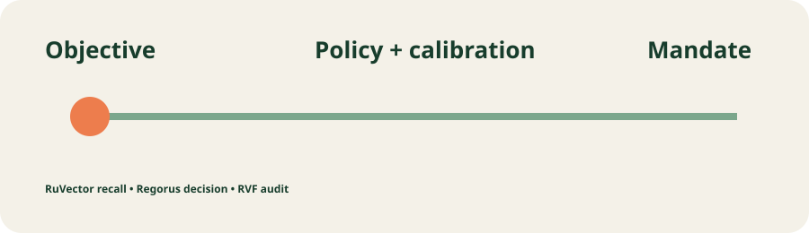

# Mandate Mesh



Mandate Mesh is a governed delegation control plane for teams that need several AI agents to act together without granting blanket authority. It decomposes an objective into a role-labelled DAG, calibrates contextual capability, forms a separation-of-duty team, evaluates a real Rego policy, issues a least-authority contract, recalls analogous mandates with RuVector, and appends the result to a durable RVF audit.

## Run the prototype

Prerequisites: Linux, Rust 1.99, Node 20.20+, and Chromium for Playwright.

```bash
npm ci --prefix frontend
npx --prefix frontend playwright install chromium
./scripts/start.sh
```

Open [http://127.0.0.1:5173](http://127.0.0.1:5173). The API readiness endpoint is `http://127.0.0.1:18080/readyz`. Stop with `./scripts/stop.sh`; reset deterministic test state with `./scripts/reset.sh`.

## Product journeys

1. **Form a governed team:** submit an objective; the UI displays selected agents, task order, calibrated risk and the contract hash returned by the Rust API.
2. **Deny and recover:** choose `restricted`; Regorus denies before any RVF write. Refresh proves the audit count is unchanged, then an `internal` retry succeeds.
3. **Restore after restart:** `./scripts/restart-journey.sh` creates a mandate, terminates the real service, reopens RVF, and verifies the saved ID through the API.

## Composition

| Ingredient | Pinned version | Executed responsibility | Evidence |
|---|---:|---|---|
| RuVector Core | 2.4.0 | HNSW insert/search for analogous mandates | `mm-ruvector` test and primary path |
| RVF Runtime | 0.3.2 | append-only mandate envelope, reopen/read | `mm-rvf`, restart journey |
| Microsoft Regorus | 0.13.0 | Rego authorization and denial | `mm-regorus`, denial journey |
| Contextual calibration | arXiv:2604.17950 | role-context scores and abstention threshold | `mm-calibration` |
| Selective risk control | arXiv:2603.24704 | refuse issuance above risk limit | ablation evidence |

No single ingredient can decompose objectives, select a team, enforce least authority, preserve a durable contract and render the outcome. The application-level composition lives in `mm-orchestrator`; the versioned Axum boundary lives in `mm-api`.

## Verification

```bash
./scripts/verify-prototype.sh
```

The script runs structural checks, formatting, strict Clippy, locked Rust tests, Cargo deny, npm audit, frontend typecheck/lint/unit/build, contract drift, executed ingredient ablations, both Playwright viewports against the real API, and restart retrieval. Raw evidence is under `evidence/`.

## Workspace and design

The [architecture](docs/architecture.md) maps all 27 Rust crates to a bounded context, caller and acceptance evidence. See the [integration matrix](docs/integration-matrix.md), [prototype acceptance map](docs/prototype-acceptance.md), [25 ADRs](docs/adr/index.md), [12 DDD notes](docs/ddd/index.md), and [semantic review](evidence/semantic-review.md).


## Deployment and limits

Docker Compose supplies the same frontend/API topology. `deploy/cloudrun-service.yaml` and `deploy/rollback.sh` are configuration only: no cloud deployment or spend was performed. Local RVF is single-instance prototype persistence; production requires an authorized shared RuVector/RVF/Cloud SQL boundary and IAM-scoped secret delivery. Prototype auth uses a local bearer token from environment configuration, never browser service credentials. The Cargo policy carries one documented non-exploit maintenance exception inherited from RuVector; see `docs/security.md`.
